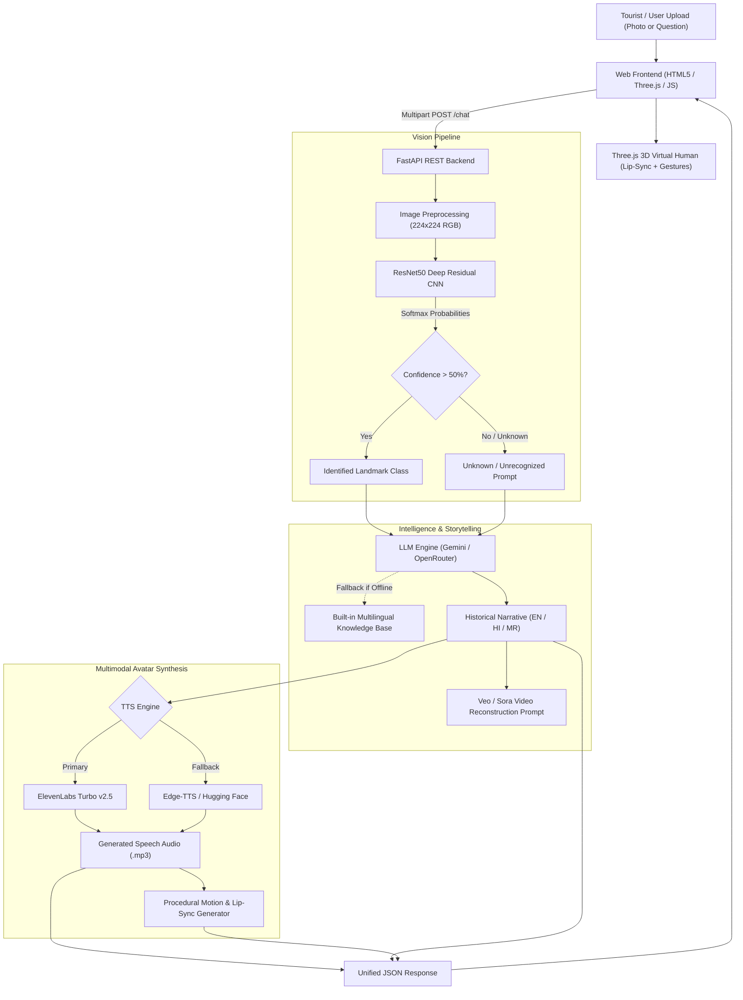

# HistTwin AI 🏰🚩
### AI-Powered Historical Site Recognition & Generative Digital Twin Guide for Raigad Fort

[](https://www.python.org/)
[](https://fastapi.tiangolo.com/)
[](https://www.tensorflow.org/)
[](https://threejs.org/)
[](https://openrouter.ai/)
[](https://elevenlabs.io/)
[](https://git-lfs.com/)
[](LICENSE)

---

## 📖 Executive Summary

**HistTwin AI** is an end-to-end intelligent heritage tourism and digital preservation platform designed for **Raigad Fort**—the historic capital of Chhatrapati Shivaji Maharaj's Maratha Empire in Maharashtra, India. 

Heritage tourism at historical forts and monuments frequently suffers from an acute lack of real-time, context-sensitive, and multilingual digital guidance. Visitors often encounter fragmented physical signboards or generic internet searches that fail to capture the deep architectural significance and heroic folklore of individual structures.

**HistTwin AI** solves this problem by combining:
1. **Deep Residual Convolutional Neural Networks (ResNet50)** for instant, fine-grained visual identification of key historical fort structures from tourist photos.
2. **Generative AI Storytelling Engines (Google Gemini & OpenRouter LLMs)** for vivid, historically accurate chronicles and dynamic interactive Q&A in **English, Marathi (मराठी), and Hindi (हिंदी)**.
3. **Interactive 3D Virtual Human Tour Guide (Three.js WebGL)** featuring real-time lip-syncing and procedural speech gestures.
4. **Dual Neural Speech Synthesis (ElevenLabs Turbo v2.5 & Microsoft Edge / Hugging Face Neural Voices)** delivering lifelike audio storytelling.
5. **AI Cinematic Reconstruction Prompts (Google Veo / Sora)** to visualize the fort in its historic 17th-century glory.

---

## 🌟 Key Features

- 📸 **Fine-Grained Heritage Landmark Recognition**
  - Custom fine-tuned **ResNet50** CNN trained on 990 verified images.
  - Recognizes 5 iconic structures of Raigad Fort plus an "Unknown / Non-Heritage" detector with **~91% validation accuracy**.
- 🎙️ **Multilingual Generative Storytelling**
  - Deep historical chronicles detailing military architecture, legends, and folklore in **English**, **Hindi (हिंदी)**, and **Marathi (मराठी)**.
  - Zero-downtime built-in offline knowledge base ensuring visitors receive instant, rich responses even in low-connectivity environments.
  - Contextual conversational Q&A allowing visitors to ask follow-up questions about the identified location.
- 💃 **Interactive 3D Virtual Tour Guide**
  - Real-time 3D avatar viewport powered by **Three.js (WebGL)** directly in the browser.
  - Live phoneme-based lip synchronization and procedural body gesture animation matched to spoken narration.
  - Switchable avatars: *Interactive 3D Guide*, *Indian Heritage Sculpture*, *Stylized 3D Character*, and *Futuristic Robot*.
- 🔊 **Dual Neural Audio Synthesis (TTS)**
  - **ElevenLabs Turbo v2.5**: Expressive, character-driven voice acting for high-immersion storytelling.
  - **Edge-TTS / Hugging Face**: Ultra-fast neural fallback providing crisp, zero-latency voices in all three languages.
- 🎬 **Cinematic Video Generation Prompts**
  - Generates optimized, high-fidelity prompts for state-of-the-art video generation models (e.g., Google Veo, OpenAI Sora) to recreate historic scenes and architectural reconstructions.
- 💻 **Modern Glassmorphism Web App & RESTful API**
  - Built with **FastAPI** backend and responsive HTML5/CSS3 frontend.
  - Features real-time camera capture, drag-and-drop file upload, audio playback controls, and an interactive conversation stream.

---

## 🏛️ Supported Heritage Landmarks

HistTwin AI is fine-tuned to classify and narrate the history of the following key monuments at Raigad Fort:

| Landmark | Marathi Name | Historical & Architectural Significance |
| :--- | :--- | :--- |
| **Hirkani Buruj** | हिरकणी बुरुज | Legendary sheer bastion built upon the steep cliff scaled by the milkmaid Hirkani to reach her infant child; honored by Chhatrapati Shivaji Maharaj. |
| **Jagadishwar Temple** | जगदीश्वर मंदिर | Sacred Shiva temple with Indo-Islamic dome architecture. Features the famous humble inscription on the entrance step: *"Seveche Thayi Tatpar Hiroji Indulkar"*. |
| **Maha Darwaja** | महादरवाजा | Colossal, impregnable main portal protected between 65-foot bastions, designed with a curved zigzag approach and iron elephant spikes. |
| **Shivaji Maharaj Samadhi** | छत्रपती शिवाजी महाराज समाधी | Sacred eternal memorial and pilgrimage site honoring Chhatrapati Shivaji Maharaj, revitalized by Mahatma Jyotirao Phule and Lokmanya Tilak. |
| **Takmak Tok** | टकमक टोक | Breathtaking 1,200-foot knife-edge precipice used historically as a point of strict royal justice against treason. |
| **Unknown / Other** | अज्ञात स्थळ | Robust rejection class preventing false positives when users upload unrelated objects, landscapes, or non-fort imagery. |

---

## 🏗️ System Architecture



---

## 📊 Dataset & Model Evaluation

The custom Raigad Fort dataset consists of **990 labeled images** across 6 distinct classes, verified for data integrity and duplicate elimination.

### Dataset Breakdown

```
================================================================================
Class Name                               | Total Images | Validated Non-Corrupt
--------------------------------------------------------------------------------
Raigad Fort Hirkani Buruj                | 117          | 117
Raigad Fort Jagadishwar Temple           | 228          | 228
Raigad Fort Maha Darwaja                 | 139          | 139
Raigad Fort Shivaji Maharaj Samadhi      | 143          | 143
Raigad Fort Takmak Tok                   | 183          | 183
Unknown (Non-Fort / Rejection Class)     | 180          | 180
--------------------------------------------------------------------------------
TOTAL                                    | 990 Images   | 100% Verified
================================================================================
```

### Model Training Pipeline
- **Backbone**: Pre-trained ResNet50 (ImageNet weights).
- **Two-Stage Transfer Learning**:
  - *Stage 1 (Feature Extraction)*: Frozen convolutional base with custom classification head (GlobalAveragePooling2D → Dense(256, ReLU) → Dropout(0.4) → Softmax).
  - *Stage 2 (Fine-Tuning)*: Unfreezing top residual blocks (`conv5_block1` onwards) with a low learning rate (`1e-5`).
- **Data Augmentation**: Random rotation, zoom, horizontal flip, and contrast adjustment to combat varied mountain lighting conditions.
- **Validation Accuracy**: **~91%** across test splits.

---

## 📁 Repository Structure

```
HistTwin-AI/
├── .env.example                     # Environment variables configuration template
├── .gitignore                       # Clean Git ignore rules (excludes models/secrets)
├── .gitattributes                   # Git LFS configuration for large binary files
├── requirements.txt                 # Python project dependencies
├── README.md                        # Comprehensive project documentation
│
├── api.py                           # FastAPI application entry point & REST endpoints
├── predict_place.py                 # ResNet50 inference, LLM storytelling, & fallback logic
├── train_model.py                   # Two-stage Transfer Learning training pipeline
├── evaluate_model.py                # Model evaluation, classification reports & confusion matrix
├── analyze_dataset.py               # Dataset audit & image verification utility
├── dataset_builder.py               # Dataset acquisition & Bing image download pipeline
├── fix_extensions.py                # MIME type validator and extension sanitizer
├── class_names.txt                  # Model class labels
├── dataset_analysis.txt             # Dataset audit summary
│
├── avatar/                          # 3D Avatar & Virtual Guide Generation Module
│   ├── __init__.py                  # Avatar package initialization
│   ├── avatar_renderer.py           # Video rendering & visual guide compositing
│   ├── lip_sync.py                  # Viseme calculation & phoneme lip-sync extraction
│   └── motion_generator.py          # Procedural 3D body motion & gesture generator
│
├── dataset/                         # Curated Raigad Fort image dataset (990 images)
│   └── Train/                       # Organized by landmark class folders
│
├── static/                          # Web Client & Frontend Assets
│   ├── index.html                   # Interactive web app UI (Glassmorphism layout)
│   ├── style.css                    # Modern UI styling & responsive layout
│   ├── script.js                    # Web application controller & API communicator
│   ├── avatar.js                    # Three.js 3D avatar WebGL loader & lip-sync engine
│   ├── bg.mp4                       # Ambient Sahyadri mountain background video
│   ├── logo.png                     # HistTwin AI logo
│   ├── maharashtrian_guide.png      # Traditional guide reference visual
│   ├── girl_talking.glb             # 3D Interactive talking avatar
│   ├── indian_girl_sculpture.glb    # 3D Indian sculpture avatar
│   ├── green_dress_girl.glb         # 3D Stylized girl avatar
│   ├── RobotExpressive.glb          # 3D Futuristic robot avatar
│   └── talking_character.fbx        # Rigged talking character model
│
└── Documentations/                  # Research paper drafts & architecture diagrams
    ├── Draft_Research_Paper_Raigad.md # Full academic research paper
    ├── HistTwin_AI_Research_Paper_Final.txt
    ├── confusion_matrix.png         # Model confusion matrix plot
    ├── training_results_augmented.png# Accuracy & loss learning curves
    ├── dfd_diagram.png              # Data Flow Diagrams (Level 0 - 3)
    ├── flowchart_diagram.png        # Complete system execution flowchart
    ├── literature_survey.png        # Comparative literature matrix
    └── sequence_diagram.png         # Multimodal interaction sequence diagram
```

---

## 🚀 Getting Started

### Prerequisites

- **Python**: Version `3.10` or higher
- **Git** & **Git LFS** (Git Large File Storage): Installed and configured on your system

### 1. Clone the Repository

```bash
git clone https://github.com/prithvi-pat-il/HistTwin-AI.git
cd HistTwin-AI
```

### 2. Set Up a Virtual Environment

```bash
# Windows
python -m venv .venv
.venv\Scripts\activate

# macOS / Linux
python3 -m venv .venv
source .venv/bin/activate
```

### 3. Install Dependencies

```bash
pip install --upgrade pip
pip install -r requirements.txt
```

### 4. Configure Environment Variables

Create a `.env` file by copying the provided `.env.example`:

```bash
cp .env.example .env
```

Open `.env` and configure your API keys:

```env
# OpenRouter API Key (https://openrouter.ai/keys)
OPENROUTER_API_KEY=your_openrouter_api_key_here

# Google AI / Gemini API Key (https://aistudio.google.com/)
GEMINI_API_KEY=your_google_ai_or_veo_api_key_here
VEO_API_KEY=your_google_ai_or_veo_api_key_here

# ElevenLabs Speech Synthesis API Key & Voice IDs (https://elevenlabs.io/)
ELEVENLABS_API_KEY=your_elevenlabs_api_key_here
ELEVENLABS_USER_SHARED_VOICE_ID=DJDkcaY4POaxra3iaZ5b
ELEVENLABS_BOY_VOICE_ID=TX3LPaxmHKxFdv7VOQHJ

# Hugging Face Access Token (https://huggingface.co/settings/tokens)
HF_TOKEN=your_huggingface_token_here
```

> **Note**: Even without paid API keys, HistTwin AI will automatically fall back to its **built-in multilingual historical knowledge base** and **free Microsoft Edge Neural TTS**, guaranteeing uninterrupted functionality!

---

## 🏃 Running the Application

### Start the HistTwin AI Server

Run the FastAPI web server using Python:

```bash
python api.py
```

Or using Uvicorn directly:

```bash
uvicorn api:app --host 0.0.0.0 --port 8080 --reload
```

Open your browser and navigate to:
```
http://localhost:8080
```

### Using the Web Application

1. **Upload or Capture**: Upload an image of any structure from Raigad Fort or use your device camera.
2. **Select Language**: Choose between **English**, **Hindi (हिंदी)**, or **Marathi (मराठी)**.
3. **Choose Voice Engine**: Select **ElevenLabs Turbo** or **Hugging Face / Edge Neural**.
4. **Select 3D Guide**: Pick your preferred avatar from the dropdown.
5. **Explore & Chat**: Listen to the animated 3D guide narrate the history, and ask any follow-up questions in the chat box!

---

## 🧠 Training & Evaluating the Model

### Train the ResNet50 Classifier

To train the classification model on the dataset from scratch:

```bash
python train_model.py
```
This executes data augmentation, two-stage transfer learning, computes class weights, and saves the best model to `raigad_places_model.keras`.

### Evaluate Model Performance

To generate the classification report, validation loss/accuracy curves, and confusion matrix:

```bash
python evaluate_model.py
```

### Audit Dataset Integrity

To verify image extensions, detect duplicates, and check for corrupted files:

```bash
python analyze_dataset.py
```

---

## 🔌 API Reference

### Unified Chat Endpoint

```http
POST /chat
```

Accepts multipart form-data for both image recognition and text conversation.

#### Request Parameters:

| Parameter | Type | Required | Description |
| :--- | :--- | :--- | :--- |
| `file` | Binary File | Optional | Image of the landmark to classify (`.jpg`, `.png`, etc.) |
| `text` | String | Optional | User's question or conversation message |
| `language` | String | Optional | Preferred language: `"English"`, `"Hindi"`, or `"Marathi"` (Default: `"English"`) |
| `context_place` | String | Optional | The currently active fort landmark context for follow-up questions |
| `tts_engine` | String | Optional | TTS voice provider: `"elevenlabs"` or `"huggingface"` (Default: `"elevenlabs"`) |

#### Sample Response:

```json
{
  "type": "prediction",
  "prediction": "Raigad Fort Hirkani Buruj",
  "confidence": 0.9421,
  "text": "Perched on the sheer eastern precipice of Raigad Fort...",
  "response": "Perched on the sheer eastern precipice of Raigad Fort...",
  "text_lines": [
    "Perched on the sheer eastern precipice of Raigad Fort...",
    "In the late 17th century, when Raigad was the glorious capital..."
  ],
  "audio_url": "/speech_1792052329469.mp3",
  "video_url": null,
  "motion_url": "/motion_speech_1792052329469.json",
  "tts_engine": "elevenlabs"
}
```

---

## 🔬 Research & Citations

This project is backed by comprehensive research documentation on cultural heritage preservation, deep residual networks, and generative multimodal AI guides. See [`Documentations/Draft_Research_Paper_Raigad.md`](Documentations/Draft_Research_Paper_Raigad.md) for the complete academic manuscript.

If you find this work helpful in your research or educational projects, please cite:

```bibtex
@misc{patil2026histtwin,
  title={HistTwin AI: An AI-Powered Historical Site Recognition and Generative Virtual Tour Guide for Raigad Fort Using Deep Residual Networks},
  author={Patil, Prithviraj and Contributors},
  year={2026},
  howpublished={\url{https://github.com/prithvi-pat-il/HistTwin-AI}}
}
```

---

## 🗺️ Roadmap & Future Scope

- [ ] **Augmented Reality (AR) Mobile App**: Native ARCore/ARKit integration for on-site overlay of historical reconstructions.
- [ ] **Additional Maratha Forts**: Expanding dataset to include Rajgad, Pratapgad, Torna, Sinhagad, and Murud-Janjira.
- [ ] **Edge AI Deployment**: Quantized INT8 TensorFlow Lite model for on-device, offline inference on low-cost smartphones.
- [ ] **3D Point Cloud Photogrammetry**: Digital twin reconstruction of ruined bastions using Gaussian Splatting and NeRF.

---

## 🤝 Contributing

Contributions, issues, and feature requests are welcome!
Feel free to check the [issues page](https://github.com/prithvi-pat-il/HistTwin-AI/issues).

1. Fork the Project
2. Create your Feature Branch (`git checkout -b feature/AmazingFeature`)
3. Commit your Changes (`git commit -m 'Add some AmazingFeature'`)
4. Push to the Branch (`git push origin feature/AmazingFeature`)
5. Open a Pull Request

---

## 📄 License

Distributed under the MIT License. See `LICENSE` for more information.

---

<div align="center">
  <b>Developed with pride for the preservation of Indian Cultural Heritage 🚩</b><br>
  <i>Dedicated to the eternal legacy of Chhatrapati Shivaji Maharaj and the Maratha Empire.</i>
</div>
